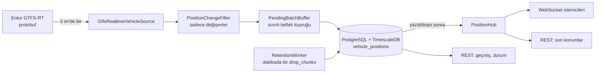

# LiveTracker — Canlı Araç Takip Servisi

Entur'un (Norveç) GTFS-Realtime araç konumu akışını 3 saniyede bir okuyan, değişen konumları PostgreSQL + TimescaleDB'ye yazan, son 3 saati tutup eskisini otomatik silen ve sonucu WebSocket ve REST ile sunan bir ASP.NET Core 8 servisidir.

Video anlatımı: [VIDEO_LINKI_BURAYA](VIDEO_LINKI_BURAYA)

## Hızlı başlangıç

Gereken tek şey Docker Desktop. Depoyu klonlayıp kök klasörde şunu çalıştırın:

```bash
docker compose up --build -d
```

- Swagger: http://localhost:8080/swagger
- Sağlık: http://localhost:8080/health
- Sistem durumu: http://localhost:8080/api/status
- WebSocket: `ws://localhost:8080/ws/positions`
- Logları izlemek için: `docker compose logs -f app`
- Durdurmak için: `docker compose down` (veriyi de silmek için `docker compose down -v`)

Bu akış temiz bir klonda baştan sona denendi: klonlama, `docker compose up --build -d`, birkaç dakika sonra `/api/status` içinde `healthy`.

### Silmeyi canlı görmek (demo modu)

Saklama süresi 3 dakikaya, parça (chunk) boyu 1 dakikaya iner; silme birkaç dakikada görülür.

```bash
docker compose down -v
docker compose -f docker-compose.yml -f docker-compose.demo.yml up --build -d
docker compose logs -f app   # "Silme: N chunk dusuruldu" satırlarını izleyin
```

Normal moda dönmek için: `docker compose down -v` ve ardından `docker compose up --build -d`.

## Mimari

Bağımlılıklar yalnızca içe doğru akar: Api → Infrastructure → Application → Domain.

| Katman | İçindekiler | Sorumluluk |
| --- | --- | --- |
| Domain | `VehiclePosition` | Hiçbir şeye bağlı olmayan veri şekli |
| Application | Filtre, kuyruk, toplama (ingestor), saklama işi, `PositionHub`, arayüzler | İş kuralları; veritabanı ve HTTP bilmez |
| Infrastructure | Entur istemcisi, EF Core/Npgsql, TimescaleDB SQL'leri | Dış dünyaya dokunan her şey |
| Api | `Program.cs`, arka plan işçileri, controller'lar, WebSocket kapısı | Bağlama ve sunum |



Bir okuma turu (3 saniyede bir):

1. `GtfsRealtimeVehicleSource` Entur'dan protobuf indirir ve çözer (gece ~5.200, gündüz ~9.000 araç).
2. `PositionChangeFilter` sadece değişenleri seçer (çok eski, gelecekteki, aynı ve sırası bozuk kayıtları eler).
3. Seçilenler `PendingBatchBuffer` kuyruğuna alınır.
4. Kuyruk, `PostgresVehiclePositionStore` ile tek sorguda toplu yazılır.
5. Yazılan her tur `PositionHub` üzerinden WebSocket istemcilerine yayınlanır.

Saklama ayrı bir işçide çalışır: `RetentionWorker` her dakika eski chunk'ları düşürür.

## Veri akışı hakkında bulgular

Kod yazmadan önce akışı bir gözlem aracıyla (`LiveTracker.FeedObserver`) saatlerce izledim. Tasarımı belirleyen bulgular:

- **Kararlı anahtar `entity id`'dir.** `vehicle id` benzersiz değil; aynı değeri birden fazla kayıt taşıyabiliyor.
- **Başlık zaman damgası güvenilmez.** 10 dakikada 26 kez geriye gitti. Bu yüzden "yeni mi?" kararını her kaydın kendi zamanıyla veriyorum.
- **Okumaların çoğu tekrar.** Her turda ~5.000–9.000 araçtan, yeni veri gelen turlarda bile sadece ~1.300–2.100'ü gerçekten yeni. Feed yaklaşık her 10 saniyede bir yenilendiği için aradaki turların çoğunda hiçbir şey değişmiyor.
- **(0, 0) koordinatlar aralıklı gelebiliyor**; doğrulamada elenir.
- Okuma süresi medyan ~200 ms (p95 ~400 ms), yanıt ~1,8 MB (gece ~1 MB). 3 saniyelik tur süresinin çok altında.

## Veri modeli ve saklama

Tek tablo: `vehicle_positions`, TimescaleDB hypertable (`recorded_at` üzerinden 15 dakikalık chunk).

```sql
-- migration'dan özet
CREATE TABLE vehicle_positions (
    entity_id        text        NOT NULL,
    recorded_at      timestamptz NOT NULL,
    vehicle_id       text        NOT NULL,
    trip_id          text,
    route_id         text,
    latitude         double precision NOT NULL,
    longitude        double precision NOT NULL,
    bearing          real,
    current_status   integer,
    stop_id          text,
    occupancy_status integer,
    ingested_at      timestamptz NOT NULL,
    PRIMARY KEY (entity_id, recorded_at)
);
SELECT create_hypertable('vehicle_positions', 'recorded_at',
       chunk_time_interval => INTERVAL '15 minutes');
CREATE INDEX ix_vehicle_positions_vehicle_time
       ON vehicle_positions (vehicle_id, recorded_at DESC);
```

- **Birincil anahtar** `(entity_id, recorded_at)`: aynı kayıt iki kez gelirse ikinci yazım sessizce atlanır (`ON CONFLICT DO NOTHING`). Hypertable bölme sütununun anahtarda bulunması gerektiği için `recorded_at` da anahtarda.
- **İndeks** `(vehicle_id, recorded_at DESC)`: bir aracın geçmişi sorgusu tabloyu taramadan bu indeksle çalışır.
- **Toplu yazma:** Her tur tek bir `INSERT ... SELECT * FROM unnest(...)` ile yazılır; kayıt başına gidiş yok.

### Otomatik silme

`RetentionWorker` her dakika `drop_chunks` çağırır; sınır = şimdi − 3 saat. `DELETE` kullanmadım: milyonlarca satırı tek tek silmek tabloyu şişirir ve `VACUUM` ister. Chunk düşürmek bir dosyayı silmektir ve milisaniyeler sürer.

Chunk bütün olarak düştüğü için veri 3 saat + en fazla 15 dakika durur. Temiz klonda ölçüm (saat 13:35 UTC): en eski kayıt 10:30, yani 3 saat 5 dakika. Bu yüzden geçmiş sorgusu ayrıca `recorded_at >= şimdi − 3 saat` filtresi uygular ve API tam 3 saati döndürür. Saklama süresi ve chunk boyu yapılandırmadan gelir.

### Hacim (ölçümlerle)

| Ölçüm | Değer |
| --- | --- |
| Yoğun saat (hafta içi, 12:00–13:00 UTC), kesintisiz bir saat | 1.041.201 satır ≈ 290 satır/sn |
| Temiz klonda dolu 3 saatlik pencere | 2.487.030 satır, 1002 MB (≈ 403 bayt/satır, indeks dahil) |
| Önceki uzun ölçüm | akşam ~94 satır/sn, 17 saatlik ortalama ~54 satır/sn; silmesiz 17 saat = 3.355.849 satır, 1386 MB (≈ 431–438 bayt/satır) |
| Yoğun saatte saatlik disk | ≈ 0,4 GB/saat |
| 3 saatlik pencere, yoğun hızda | ≈ 3 milyon satır ≈ 1,2–1,3 GB |
| 10 gün, silme olmadan | ≈ 37 GB (akşam hızı) – ≈ 100 GB (yoğun hız sürekli olsaydı) |

Silme açıkken tablo 3 saatlik pencerede sabit kalır; silme olmadan 10 günde onlarca GB'a çıkardı.

### Saklama süresi 10 gün olsaydı?

Mekanizma aynı kalır: `drop_chunks` süreyi değil chunk'ları siler, yapılandırmada `Retention:Window` değişir. Değişen şey boyuttur: yukarıdaki tabloya göre 37–100 GB. Önlemler:

- **Sıkıştırma:** TimescaleDB eski chunk'ları kolon bazlı sıkıştırabilir; bu tür sık tekrar eden veride genelde birkaç kat küçülme sağlar. Ölçmedim, tahmin olarak yazıyorum.
- **Chunk boyu:** 15 dakika 3 saatlik pencere için uygun (12 chunk). 10 gün için 1 saatlik ya da daha büyük chunk daha az dosya ve daha az planlama yükü demek; ama chunk büyüdükçe silme "ince" olmaz (veri daha fazla fazladan durur).
- **Geçmiş sorgusu:** `(vehicle_id, recorded_at DESC)` indeksi ve zaman filtresi sayesinde tablo büyüse de bir aracın geçmişi hızlı kalır; indeks tabloyla birlikte büyür (yaklaşık %47'si indeks).
- **Yazma yükü** değişmez; yalnızca disk ve yedekleme maliyeti artar.

### Neden TimescaleDB, neden diğerleri değil?

- **Düz PostgreSQL + elle bölümleme:** Yapılabilir (`PARTITION BY RANGE` + her 15 dakikada yeni bölüm açan/eskiyi düşüren bir iş), ama bu işi kendim yazmak ve bakımını yapmak zorunda kalırdım. TimescaleDB aynı fikri hazır veriyor ve hâlâ standart SQL/EF Core ile konuşuyorum.
- **Düz PostgreSQL + `DELETE`:** Saatte ~1 milyon satırı silmek tabloyu şişirir, `VACUUM` yükü getirir ve yazmayla yarışır. Reddettim.
- **Redis (TimeSeries/Streams):** Veri bellekte durur; 3 milyon satırlık pencere RAM'de pahalı olurdu ve "bir aracın son 3 saati" gibi sorgular SQL kadar rahat olmazdı. Dayanıklılık için ayrıca ayar ister. Yayın (fan-out) için iyi bir aday, ama zaten WebSocket yayınını uygulamada `PositionHub` ile yapıyorum.
- **Kafka veya benzeri kuyruk:** Bu ölçekte (~300 satır/sn) gereksiz işletim yükü; tek örnekli servis için fazla.

## Veri kaybı yönetimi

Dört temel senaryo. Her biri için: ne kaybolur, ne korunur, neden.

| Senaryo | Ne kaybolur | Ne korunur | Neden / nasıl |
| --- | --- | --- | --- |
| **Kaynak (Entur) erişilemez ya da bozuk yanıt verir** | Erişilemeyen süredeki konumlar geri alınamaz; Entur geçmiş sunmuyor. | Önceden yazılmış her şey. Uygulama çökmez, kendiliğinden toparlanır. | Okuma hatası yakalanır, `/api/status` içinde `degraded` olur ve `failedAttempts` artar; döngü her 3 saniyede yeniden dener. |
| **Veritabanı erişilemez** | Kuyruk dolarsa (200.000 satır ≈ 30 dk) en eski satırlar atılır ve hata loglanır. | Kesintiden önce yazılanlar; kesinti kısa sürerse hiçbir şey kaybolmaz. | Yazılamayan tur sınırlı bellek kuyruğunda bekler; veritabanı dönünce en eskiden başlayarak yazılır. |
| **Uygulama yeniden başlar / çöker** | Bellekteki yazılmamış kuyruk ve kapalı kalınan sürede kaçan okumalar. Normal işleyişte kuyruk boştur (her tur hemen yazılır), yani pratikte birkaç saniye. | Veritabanındaki tüm veri; çift kayıt oluşmaz. | Açılışta "gördüm" listesi boştur, ilk tur her aracı yeniden gönderir ama birincil anahtar + `ON CONFLICT DO NOTHING` bunları eler. |
| **WebSocket istemcisi kopar ya da yavaşlar** | Hiçbir kalıcı veri kaybolmaz. İstemci kapatılırsa o anki yayını kaçırır. | Veritabanı ve diğer istemciler. İstemci `lastSeq` ile kaçırdığını geri alır. | İstemci başına sınırlı kuyruk; dolarsa ya da 10 sn'de mesaj alamazsa istemci kapatılır, yayıncı beklemez. |

Ek önlemler: aynı veri iki kez gelirse zararsız; bozuk kayıt sayılır (`gecersiz`) ve elenir, tur düşmez.

### Denenenler

- **Veritabanı kesintisi:** Veritabanı yaklaşık 3,5 dakika durduruldu; kuyruk 737 → 23.669 satıra çıktı. Dönünce tek turda 24.201 satır yazıldı (kuyruk 0), dakikalık sayımlarda boşluk yok.
- **Kaynak erişilemez:** `Ingestion__FeedUrl` var olmayan bir adrese çevrildi. ~10 dakikada 212 başarısız deneme; uygulama ayakta kaldı, `/api/status` `degraded` döndü ve nedeni gösterdi (`Name or service not known`). Adres düzeltilince bir dakika içinde `healthy`, `failedAttempts` 0.
- **Uygulama restart:** `docker compose restart app` sonrası yazma kaldığı yerden devam etti; `(entity_id, recorded_at)` bazında çift satır sorgusu 0 satır döndü.
- **Gerçek bir kayıp örneği:** Geliştirme sırasında bilgisayar bir süre uykuya geçti; o saatlerde uygulama da çalışmadığından o dönemin kayıt sayısı çok düşük (08:00 UTC saatinde 725 satır). Kaynak geçmiş sunmadığı için bu veri geri alınamaz. Üretimde servis sürekli açık bir makinede çalışacağı için bu bir kullanım şartıdır, kod hatası değil.

### Bilinen sınırlar (dürüstçe)

- Kuyruk bellekte tutulur; uygulama kapanırsa içindekiler kaybolur. Çözüm disk tabanlı kuyruk olurdu; kapsam dışı bıraktım.
- Entur'a erişilemeyen ya da uygulamanın kapalı olduğu sürede kaçan veri geri alınamaz.
- Hub bellekte olduğu için tek uygulama örneği varsayıyorum.

## WebSocket

Adres: `ws://localhost:8080/ws/positions?lastSeq=<son alınan seq>`

- Yeni bağlanan önce `snapshot` (her aracın son konumu), sonra yaklaşık 3 saniyede bir `update` alır.
- Her mesaj `{"type": "snapshot" | "update", "seq": N, "positions": [...]}` biçimindedir; `seq` her tura verilen artan numaradır.
- Bağlantısı kopan istemci son `seq`'ini `lastSeq` ile verirse kaçırdığı turlar sırayla tekrar gönderilir (son 1200 tur ≈ 1 saat bellekte tutulur). Numara çok eskiyse ya da uygulama yeniden başlamışsa snapshot verilir (`seq` uygulama açılışında Unix zamanından başlar, bu yüzden eski numara yeni sayaçla karışmaz).
- **Yavaş istemci izolasyonu:** Her istemcinin sınırlı bir kuyruğu var (`Streaming:ClientQueueBatches`, varsayılan 100 tur). Kuyruğu dolan ya da 10 saniyede mesaj alamayan istemci kapatılır; yayıncı hiçbir zaman beklemez, diğer istemciler etkilenmez. İstemci `lastSeq` ile geri dönebilir.
- Yayın, veri veritabanına yazıldıktan sonra yapılır; WebSocket'ten görülen her veri kalıcıdır.

Denemek için tarayıcıda Swagger sayfasında `F12` ile konsola:

```js
const ws = new WebSocket('ws://localhost:8080/ws/positions');
ws.onmessage = e => { const m = JSON.parse(e.data); console.log(m.type, m.seq, m.positions.length); };
```

Tekrar gönderme denemesi: son gelen `seq` değerinden birkaç eksik bir sayıyla `?lastSeq=` vererek yeni bir bağlantı açın; aradaki turlar sırayla gelir.

## REST

| Uç nokta | Ne verir |
| --- | --- |
| `GET /api/vehicles/latest?routeId=` | Her aracın bilinen son konumu (bellekten, son 3 saat içinde) |
| `GET /api/vehicles/{vehicleId}/positions?from=&to=&before=&limit=` | Aracın geçmişi, yeniden eskiye. `from`/`to` (ISO 8601) isteğe bağlı zaman aralığıdır; her zaman son 3 saatle kesiştirilir. `from` ≥ `to` ise 400. `limit` 1–1000. Sonraki sayfa için dönen `nextBefore` değeri `before` olarak verilir. |
| `GET /api/status` | Son başarılı okuma, başarısız deneme, son hata, son 1 saatte yazılan kayıt, bekleyen kuyruk, WebSocket istemci sayısı; 30 sn'dir başarılı okuma yoksa `degraded` |
| `GET /health` | Uygulama ayakta mı |

Sayfalama "keyset" yöntemiyle yapılır (son kaydın zamanından devam); büyük tabloda `OFFSET` kullanmaktan hızlıdır ve sıra kaymaz.

## Yapılandırma

Ortam değişkeni ya da `appsettings.json` ile (ortam değişkeninde `:` yerine `__`):

| Ayar | Varsayılan | Anlamı |
| --- | --- | --- |
| `Ingestion:FeedUrl` | Entur vehicle-positions | Kaynak adresi |
| `Ingestion:PollIntervalSeconds` | 3 | Okuma aralığı |
| `Ingestion:ClientName` | — | Entur'a giden `ET-Client-Name` başlığı |
| `Ingestion:MaxBufferedRows` | 200000 | Bellek kuyruğu sınırı |
| `Retention:Window` | 03:00:00 | Saklama süresi |
| `Retention:ChunkInterval` | 00:15:00 | Chunk boyu |
| `Retention:CleanupInterval` | 00:01:00 | Silme işinin sıklığı |
| `Streaming:ReplayBatches` | 1200 | Tekrar gönderme belleği (tur) |
| `Streaming:ClientQueueBatches` | 100 | İstemci başına kuyruk (tur) |

Ingestion ve Streaming ayarları açılışta doğrulanır; hatalı değer varsa uygulama başlamaz.

## Testler

`LiveTracker.Tests` (xUnit, 27 test): `PendingBatchBuffer` (sınır, en eskiyi atma), `PositionChangeFilter` (aynı/eski/gelecek/sırasız kayıt, `Prune`), `PositionHub` (snapshot, tekrar gönderme, yavaş istemci izolasyonu), `VehicleQueryService` (saklama penceresi kesişimi, sayfalama, limit sınırı, hat filtresi).

```bash
dotnet test
```

## Bilinen eksikler ve daha fazla zamanım olsaydı

- Disk tabanlı kuyruk (uygulama kapanınca kayıpsız).
- Kimlik doğrulama (JWT) ve istemci başına yetkilendirme.
- OpenTelemetry ile metrik ve izleme; şimdilik log ve `/api/status`.
- Yük testi ve birden fazla uygulama örneği (şu an tek örnek; hub bellekte).
- WebSocket'te bölge/hat filtreleme.
- Eski chunk'lar için TimescaleDB sıkıştırması.
- `timescale/timescaledb:latest-pg16` imajının sürümü üretimde sabitlenmeli.
